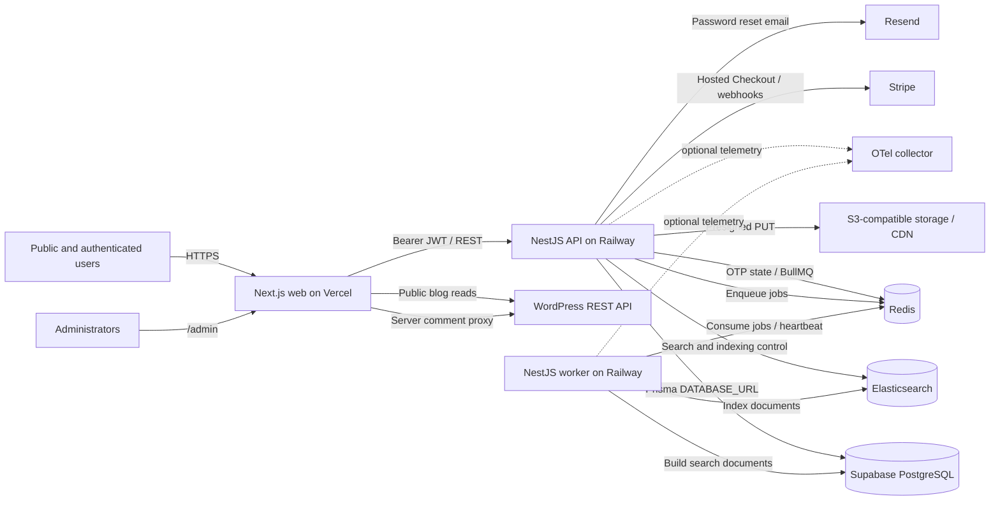

# Gharazi Project Overview

## Review scope and confidence

This baseline was produced on 7 November 2026 from the accessible `gharazi` workspace and a non-authenticated inspection of `https://gharazi.com/`. No database, deployment dashboard, private account, production record, migration, dependency, or environment value was accessed or changed.

Evidence labels used throughout this review:

- **Code verified**: implementation is present and was statically traced.
- **Build/test verified**: an existing non-destructive check completed successfully.
- **Production observed**: public output was returned by the production site.
- **Runtime unverified**: code exists, but provider configuration or an authenticated production flow was not exercised.

## Platform summary

Gharazi is a Pakistan-focused real-estate marketplace for sale/rent listings and developer projects. It combines public search and SEO landing pages with account dashboards, listing/project authoring, inquiries, chat, favorites, saved searches, professional profiles, moderation/administration, advertising packages, subscriptions, promotions, payments, analytics, and operational tooling.

The codebase is a single monorepo. There is no evidence that a second repository is required for the core product. The public blog depends on an external WordPress REST API, and production also depends on Railway, Vercel, Supabase PostgreSQL, Redis, Elasticsearch, Stripe, S3-compatible storage, and optionally Resend/OpenTelemetry.

## Technology stack

| Layer | Implementation | Evidence |
|---|---|---|
| Public/admin frontend | Next.js 15 App Router, React 19, TypeScript, Tailwind CSS, TanStack Query, React Hook Form, Zod, Zustand | `apps/web/`, `apps/web/package.json` |
| Backend API | NestJS 10 modular monolith, TypeScript, Swagger, Passport JWT, class-validator, Helmet, global throttling | `apps/api/src/main.ts`, `apps/api/src/app.module.ts` |
| Worker | Separate NestJS application with BullMQ processors | `apps/worker/src/` |
| Database | PostgreSQL via Prisma 6; Supabase is used only as hosted PostgreSQL | `prisma/schema.prisma`, `README.md` |
| Search | Elasticsearch with PostgreSQL fallback | `apps/api/src/common/elasticsearch/`, `modules/search/` |
| Ephemeral state/queues | Redis and BullMQ | `common/redis/`, `common/queues/`, `packages/shared-events/` |
| Authentication | Email/password and phone OTP, JWT bearer tokens, database session records | `modules/auth/`, `common/auth/` |
| Media | S3-compatible presigned PUT uploads and media metadata in PostgreSQL | `modules/media/`, listing/project media models |
| Payments | Stripe hosted Checkout and webhook processing | `modules/payments/`, Stripe migration |
| Email | Resend boundary for password-reset email | `modules/email/email.service.ts` |
| Blog | Headless WordPress REST API rendered by Next.js | `apps/web/lib/api/wordpress.ts` |
| Observability | Structured JSON logging, request IDs, system events, optional OpenTelemetry; Sentry variables are reserved but no SDK transport is implemented | shared utils, health/system-events modules |
| Local services | Docker Compose for PostgreSQL, Redis, Elasticsearch, OpenTelemetry collector | `docker-compose.yml` |

## Repository structure

```text
apps/
  web/       Next.js public site, account dashboard, and primary admin UI
  api/       NestJS HTTP/WebSocket API
  worker/    BullMQ consumers and worker heartbeat
  admin/     legacy static admin fallback (not the primary UI)
packages/
  shared-config/ shared environment validation and Redis parsing
  shared-events/ queue names, payload contracts, retry options
  shared-types/  cross-application TypeScript contracts
  shared-utils/  IDs, normalization, logging, telemetry helpers
prisma/
  schema.prisma
  migrations/   13 timestamped migration directories
  seed.ts
docs/project-review/ this assessment
```

## Application boundaries

- The browser calls the Railway-hosted API through `NEXT_PUBLIC_API_URL`; it does not use Supabase client APIs.
- Next.js also calls WordPress directly for public blog reads and proxies blog comment creation through `POST /api/blog/comments` so the WordPress key is not exposed to the browser.
- The API is the application security boundary for PostgreSQL. Prisma connects with `DATABASE_URL`.
- API services enqueue BullMQ work in Redis. The separate worker performs search indexing and operational jobs.
- Elasticsearch is a derived discovery index. PostgreSQL remains the source of truth and can serve configured search fallback.
- The primary admin interface is part of the Next.js app under `/admin`; `apps/admin` is a legacy static fallback.

## Architecture diagram



## Backend organization

The API is a modular monolith. Domain modules cover auth, users, professional/developer profiles, locations/taxonomy, listings, projects, search, favorites, saved searches, inquiries, chat, notifications, verification, moderation, submissions, CMS, promotions, subscriptions, payments, analytics, risk, admin operations, search operations, health, media, newsletter, audit, and system events.

Global controls include:

- Helmet security headers.
- explicit CORS origin list with credentials enabled.
- global class-validator transformation, field whitelisting, and rejection of unknown DTO fields.
- global IP-oriented throttling, default 120 requests per 60 seconds.
- a global exception filter and request-correlation middleware.
- Swagger at `/docs`; there is no API path prefix or versioned route namespace.

## Frontend organization

Next.js route groups separate public, authentication, and dashboard pages. Admin pages live outside the public route group but use an admin client shell. Reusable layers include API clients, query hooks, cards/galleries, search filters, authoring forms, dashboard shells, admin resource screens, SEO metadata/structured data, legal content, feedback/support forms, and design primitives.

The production homepage was observed returning live marketplace content, navigation, search controls, real listing cards, honest empty project state, disclaimers, blog guides, feedback, and newsletter forms. This was a content/semantic inspection, not a pixel-level browser or device review.

## Background processing

Recurring jobs are registered when the API module initializes:

- promotion activation every 10 minutes;
- expired promotion ending every 15 minutes;
- subscription expiry reminders daily;
- analytics rollups hourly.

Workers also exist for search indexing, notifications, saved-search alerts, payment follow-ups, subscription alerts, risk follow-ups, promotions, and analytics. Notification delivery and saved-search matching contain explicit TODO stubs; subscription expiry processing is also incomplete.

## Verification performed

| Check | Result |
|---|---|
| Root ESLint (`apps/**/*.ts`, `packages/**/*.ts`) | Passed |
| Jest | 6/7 suites passed; 11 tests passed. Admin listing-contact suite failed to initialize because `Reflect.getMetadata` was unavailable. |
| Frontend TypeScript | Passed with `tsc --noEmit --incremental false`; packaged script could not write its configured build-info path in this environment. |
| Next.js production build | Passed, generated 69 routes. External fetches were denied by the assessment sandbox during prerender, but fallbacks allowed completion. |
| Nest API/worker build | Not verified: existing `dist` files could not be unlinked (`EPERM`); this is an environment/file-permission result, not a source compilation failure. |

## Boundaries not verified

- Railway/Vercel/Supabase dashboard settings, secrets, domains, callbacks, service commands, migration history, backups, and logs.
- Production Redis, Elasticsearch, Stripe, S3, Resend, WordPress-write, worker, or OpenTelemetry configuration.
- Authenticated production flows, admin actions, payment transactions, uploads, email/SMS delivery, or WebSocket behavior.
- Visual rendering across browsers and screen sizes; no screenshot/browser automation suite exists in the repository.

