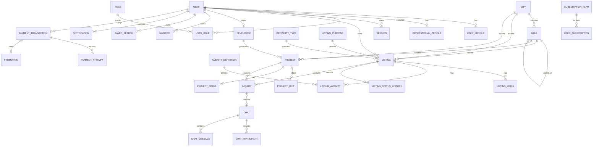

# Database Architecture

## Access model

PostgreSQL is the system of record. Supabase supplies hosted PostgreSQL only; no Supabase JavaScript client, Auth, Storage, Realtime, service-role key, or Row Level Security policy was found. The API and parts of the worker connect through Prisma using `DATABASE_URL`. `DIRECT_URL` is documented as optional for migrations but is not declared in the Prisma datasource.

The browser does not connect to PostgreSQL. Its normal path is browser → NestJS API → Prisma → PostgreSQL. Consequently, API authorization and ownership checks are the principal data-security boundary.

## Schema inventory

| Domain | Tables/models | Purpose |
|---|---|---|
| Identity | `User`, `UserProfile`, `ProfessionalProfile`, `Role`, `UserRole`, `Session`, `PasswordResetToken` | accounts, public/business profile, RBAC, session audit/revocation records, reset tokens |
| Geography/taxonomy | `City`, `Area`, `PropertyType`, `ListingPurpose`, `AmenityDefinition` | searchable reference data and hierarchical areas |
| Listings | `Listing`, `ListingMedia`, `ListingAmenity`, `ListingStatusHistory` | classified property inventory, media, attributes, lifecycle history |
| Projects | `Developer`, `Project`, `ProjectUnit`, `ProjectMedia`, `ProjectAmenity`, `ProjectUpdate` | developer identity, projects, unit inventory, progress/media |
| Engagement | `Favorite`, `SavedSearch`, `Inquiry`, `Chat`, `ChatParticipant`, `ChatMessage`, `Notification`, `NotificationDelivery` | saves, alerts, leads, messaging, notifications |
| Trust/moderation | `VerificationRequest`, `Report`, `ModerationAction`, `DuplicateCandidate`, `RiskFlag`, `AdminNote`, `AuditLog` | verification, abuse review, duplication/risk, operator history |
| Commercial | `SubscriptionPlan`, `UserSubscription`, `Promotion`, `PaymentTransaction`, `PaymentAttempt` | plans, subscriptions, paid visibility, provider state |
| Content/intake | `CmsPage`, `BlogPost`, `InboundSubmission`, `NewsletterSubscriber` | internal CMS foundation, contact/support/feedback, subscribers |
| Analytics/operations | `AnalyticsEvent`, `ListingDailyStat`, `ProjectDailyStat`, `SystemEvent` | event capture, rollups, operational incidents |

## Core listing model

`Listing` has a UUID primary key plus short unique `publicId`. It relates to one owner, optional manager, purpose, property type, city, area, media, amenities, status history, inquiries, chats, and statistics. Key attribute groups include:

- title/description and optional source URL;
- price and currency;
- area value/unit, bedrooms, bathrooms, floor data, year built, furnishing, possession;
- latitude/longitude, precision, and address;
- contact name, phone, and WhatsApp;
- string lifecycle status and verification status;
- featured/hot flags, quality/view/inquiry counters;
- published, expiry, refresh, soft-delete, created, and updated timestamps.

Code-recognized public statuses are `active`, `sold`, and `rented`. Creation starts as `draft`; user publication changes directly to `active` and assigns a 90-day expiry. Archive, sold, rented, rejected, and expired states also appear in services, but status is a free-form varchar rather than a database enum/check.

Important limitation: `expiresAt` is persisted, but public listing reads/search do not filter by it and no listing-expiry scheduler was found. Refresh updates freshness only and does not renew `expiresAt`.

## Core project model

`Project` belongs to `Developer`, `City`, `Area`, and `PropertyType`. It stores unique `publicId` and SEO slug, description, price range, area range, geo data, development/possession/legal/payment-plan fields, featured/verification/status flags, timestamps, and related units/media/amenities/updates. Public reads require `status = active`.

## User and authorization model

- `User` stores normalized phone, optional email, verification timestamps, password hash, and `UserStatus` (`ACTIVE`, `PENDING_VERIFICATION`, `SUSPENDED`, `DELETED`).
- RBAC is many-to-many through `UserRole`; known role codes include buyer, tenant, owner, agent, developer, moderator, support, and admin.
- `Session` records a token fragment, expiry, and revocation time. Current JWT validation does not consult this table, so it is not an effective online revocation boundary.
- `ProfessionalProfile` represents agent/developer/agency-style business onboarding separately from the older `Developer` entity required to create projects.

## Relationship diagram

## Constraints and indexes

The schema has useful uniqueness and access-path coverage:

- unique email, phone, role codes, public IDs, project/developer slugs, taxonomy codes/slugs;
- composite uniqueness for area/city slug, favorites, listing/project amenities, chat participants, daily stats, and duplicate candidates;
- listing/project indexes for owner/developer and status, public status/published date, city/area/status, taxonomy, and latitude/longitude;
- engagement indexes by user/status/date and chat/date;
- operational indexes for audit, risk, payments, events, and analytics.

Potential performance gaps requiring measurement:

- PostgreSQL fallback text search uses relational filters rather than a documented full-text/trigram index.
- geo columns have ordinary composite indexes, not PostGIS/geospatial indexes.
- dynamic sitemap generation can request up to 50,000 listings and 50,000 projects in batches and enumerate areas for every city.
- several admin list methods appear unpaginated or use simple limits.

## Migrations

Thirteen timestamped migration directories cover foundation through professional profiles, with later migrations for newsletter, listing-contact administration, Stripe payments, and system events. Migration SQL creates tables, foreign keys, checks, and indexes. No RLS enablement or policy SQL was found.

Schema drift was not checked against production. No migration was executed.

## Data-access and security concerns

| Finding | Assessment |
|---|---|
| No RLS | Acceptable only while all database access remains server-side and credentials are tightly scoped; it removes defense-in-depth against an API authorization defect. |
| Free-form status fields | Increases drift/invalid-state risk across listings, projects, payments, promotions, moderation, and notifications. |
| Polymorphic entity references | `Favorite`, `Report`, `Promotion`, `RiskFlag`, analytics and notes use type/id pairs without foreign keys; orphan cleanup is application-managed. |
| Session records not enforced | Revoking rows does not revoke already-issued JWTs. |
| Worker creates its own Prisma client | Search document builder owns a direct client rather than the shared lifecycle-managed service; verify connection pooling under Railway scaling. |
| Public analytics events | Event creation is unauthenticated and relies on validation/idempotency; abuse and cardinality should be monitored. |

## Unknowns

- Actual production schema/migration parity and extensions.
- Supabase connection pooler mode, connection limits, backups, point-in-time recovery, and database role privileges.
- Production row counts, query plans, slow-query data, storage growth, and retention rules.
- Whether operational jobs successfully populate daily rollups and notification deliveries in production.

