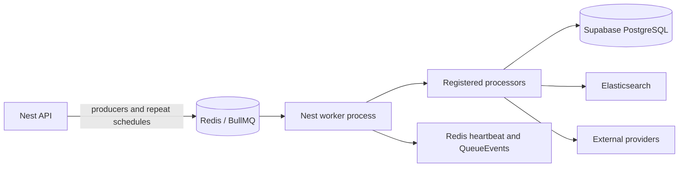

# GHARAZI-003E-02B-W — Background Worker Audit

Date: 2026-11-09  
Status: PARTIAL — source/configuration audit complete; Railway and shared-service runtime diagnosis unavailable. No source correction was justified by static evidence.

## 1. Executive summary

The repository contains a valid Nest worker application and a separate `start:worker` command. `WorkerModule` registers eight BullMQ queues and all eight processors. The source proves that Redis connectivity is required at startup, and that search indexing has an implemented Elasticsearch writer and Prisma document builder.

The source does not prove that the Railway worker is currently running, that Redis/Supabase/Elasticsearch connections work, or that any jobs are being consumed. No Railway connector/configuration or runtime credentials were available. No service was restarted and no queue state was read or changed.

Six processors contain TODO-only placeholders that return normally, so BullMQ considers their jobs complete despite no domain work. Promotion and subscription repeat schedules are registered by the API, not the worker. If the API is running while the worker is absent, scheduled jobs can accumulate. If a worker resumes, the placeholder jobs will be acknowledged without carrying out their intended work. Promotion repeat processors are not ready to activate because their intended mutations and eligibility rules are not implemented.

No automatic listing expiry job exists. The owner-reported overdue listing inventory was not changed or re-read.

## 2. Worker startup architecture

Startup path:

1. Root `start:worker` runs `nest start worker`; the build script runs `nest build worker` after API build.
2. Nest CLI worker root is `apps/worker`, source is `apps/worker/src`, entry file is `main.ts`, and its TypeScript config is `apps/worker/tsconfig.app.json`.
3. `main.ts` starts telemetry, creates the `WorkerModule` application context, installs a structured logger, logs startup, and handles SIGINT/SIGTERM by closing Nest and telemetry.
4. `WorkerModule` validates the shared environment config, creates BullMQ Redis connections from `REDIS_URL`, sets `maxRetriesPerRequest: null`, registers queues/processors, and initializes observability.
5. `SearchDocumentBuilder` creates its own `PrismaClient` using `DATABASE_URL` when invoked. It does not inject the API `PrismaService`.
6. `SearchIndexingProcessor` constructs an Elasticsearch client from `ELASTICSEARCH_URL` and requires `ELASTICSEARCH_INDEX_PREFIX` when it resolves an index alias.

The process has no HTTP health listener of its own. Liveness is inferred through a Redis heartbeat consumed by the API health endpoint. `bootstrap()` has no top-level catch/rejection logging, so startup failures may surface as an unhandled rejected promise/process exit depending on Node runtime behavior.

## 3. Railway configuration assessment

Repository evidence:

- Root package scripts: `start:worker`, `start:worker:dev`, and `build` (`nest build api && nest build worker`).
- Nest CLI project configuration maps the worker to the expected source and `main.ts` entry.
- No Dockerfile, `railway.toml`, Procfile, Nixpacks configuration, or other Railway service manifest was found in the accessible repository.
- Node engine version is not pinned in root package metadata. `.nvmrc`/`.node-version` was not found.
- `README.md` documents separate API/worker processes, but this does not establish the deployed Railway start command, working directory, build command, artifact path, restart policy, or Node version.

Consequently, a wrong Railway start command, missing worker service, bad deployment, or runtime crash remains plausible but unconfirmed. Required worker environment names include those validated centrally, especially `REDIS_URL`, `DATABASE_URL`, and for search jobs `ELASTICSEARCH_URL` plus index prefix. Values were not read or reported.

## 4. Redis, database, and Elasticsearch

- **Redis:** Worker startup requires `REDIS_URL`, parses it through shared config, and uses BullMQ connections with `maxRetriesPerRequest: null`. This establishes source configuration only. No live connection, TLS/auth check, latency, queue count, or error log was available.
- **Supabase/Prisma:** Search indexing uses a standalone Prisma client with `DATABASE_URL`; it connects lazily when a document is built. It has an `onModuleDestroy` disconnect hook. No live DB connection was attempted in this task. The prior lifecycle investigation recorded a P1001 from this sandbox; that is not proof of Railway connectivity failure.
- **Elasticsearch:** Search processor constructs the client from `ELASTICSEARCH_URL`; actual index writes/deletes occur for search-index jobs. No cluster health, auth, alias, mapping, or production document status was read.
- **Failure behavior:** BullMQ retries thrown processor errors according to shared defaults. Missing documents return `null` and are acknowledged as successfully handled. Several placeholders log and return successfully, also acknowledged as completed.

## 5. BullMQ queue and module inventory

Shared default job options: five attempts, exponential backoff starting at 5 seconds, completed jobs retained for one day/up to 1,000, failed jobs for seven days/up to 5,000. No global concurrency override is configured; BullMQ worker defaults apply. No production values were queried.

| Module / queue | API producer / trigger | Consumer / processor | Schedule | Status / important effects |
|---|---|---|---|---|
| `jobs/analytics` / `analytics-rollups` | `SchedulerModule` registers recurring `daily-rollup` (`15 * * * *`); no event producer found | `AnalyticsRollupsProcessor` | API repeat registration | PLACEHOLDER: logs then returns; intended DB aggregation into daily stats does not run |
| `jobs/notifications` / `notifications` | `NotificationsService.create(...queueDelivery)`; inquiries, chat, moderation, promotion and other domain events | `NotificationsProcessor` | Event-driven | PLACEHOLDER: logs then returns. Notification row and in-app delivery row are written by API before enqueue; email/SMS/push and delivery updates do not occur in worker |
| `jobs/payments` / `payment-followups` | Queue registered; no producer or schedule found | `PaymentFollowupsProcessor` | None found | PLACEHOLDER: logs then returns; no provider check or stale transaction expiry |
| `jobs/promotions` / `promotion-lifecycle` | `SchedulerModule` | `PromotionLifecycleProcessor` | `activate-due` every 10m; `end-expired` every 15m | PLACEHOLDER: logs then returns. Calling intended domain methods could mutate promotion/listing flags, enqueue ES jobs and create notifications; currently does none |
| `jobs/risk` / `risk-followups` | Queue registered; no producer or schedule found | `RiskFollowupsProcessor` | None found | PLACEHOLDER: logs then returns; no escalation/operations notification |
| `jobs/saved-search-alerts` / `saved-search-alerts` | Queue registered by scheduler; no producer or repeat schedule found | `SavedSearchAlertsProcessor` | None found | PLACEHOLDER: logs then returns; no Elasticsearch matching or notifications |
| `jobs/search-indexing` / `search-indexing` | `SearchIndexingService` from listing/project create/update/publish/archive/moderation/promotion paths; admin search operations | `SearchIndexingProcessor` + `SearchDocumentBuilder` | Event-driven | FUNCTIONAL IMPLEMENTATION: Prisma reads and ES index/delete writes; runtime unverified |
| `jobs/subscriptions` / `subscription-alerts` | `SchedulerModule` | `SubscriptionAlertsProcessor` | `expiry-reminder` daily at 09:00 (timezone unspecified) | PLACEHOLDER: logs then returns; no reminder or expiry mutation |

All eight modules are imported and registered as providers in `WorkerModule`; all eight queue names are registered in `BullModule.registerQueue`. Queue name constants align between producers, scheduler, and processors where producers exist.

### Scheduler details

Schedules are registered by the API’s `SchedulerModule.onModuleInit`, imported in `AppModule`, not by the worker. Registration calls `Queue.add` with stable job IDs and BullMQ repeat patterns. If multiple API replicas start, the stable repeat job IDs are intended to avoid duplicate registrations; live repeatable job state was not inspected. The analytics job name says `daily-rollup`, but the pattern `15 * * * *` runs hourly at minute 15. This is a naming/schedule mismatch; processor is currently a placeholder.

## 6. Processor implementation and operational readiness

| Processor | Classification | Acknowledges without domain work? | Side effects if fully implemented/resumed |
|---|---|---:|---|
| Search indexing | PARTIAL / functional core | No, except absent document is treated as a successful no-op | Writes/deletes Elasticsearch documents; performs PostgreSQL reads |
| Analytics rollups | PLACEHOLDER | Yes | Would write listing/project daily aggregates |
| Notifications | PLACEHOLDER | Yes | Intended external email/SMS/push and delivery status writes; API already writes in-app records |
| Payment follow-ups | PLACEHOLDER | Yes | Would query Stripe/provider and mutate payment transactions |
| Promotions | PLACEHOLDER | Yes | Intended promotion status and listing flags updates, Elasticsearch reindex, notifications |
| Risk follow-ups | PLACEHOLDER | Yes | Would change risk escalation state and notify operations |
| Saved-search alerts | PLACEHOLDER | Yes | Would query ES and enqueue/record user notifications |
| Subscription alerts | PLACEHOLDER | Yes | Would notify users and potentially mark subscriptions expired |

None of the six placeholder processors currently has a thrown “not implemented” error. BullMQ therefore has no signal to retry them. Repeated scheduled placeholders can be counted as completed despite having performed no intended operation.

## 7. Search indexing detail

The event-driven indexing path is the only processor with substantive consumer logic:

- `index-listing`/`index-project`: fetches a Prisma document, then writes to alias-backed ES index with entity ID.
- `delete-listing`/`delete-project`: deletes by ID, ignores Elasticsearch 404.
- Prisma missing entity: logs warning and returns null; job completes successfully.
- Other Prisma/ES failures throw and are subject to BullMQ retries/backoff.
- API queue producer has no explicit `jobId` deduplication or outbox transaction; DB commit can succeed while enqueue fails, and retries can create duplicate indexing jobs. Reindexing by stable ES document ID makes successful writes effectively overwrite the same document.
- No worker-side reconciliation loop runs automatically. Admin search operations can enqueue reindex work, but production reindexing was not triggered.
- Index document builder does not include listing `expiresAt`; this audit did not enable expiry or modify listing visibility.

## 8. Other API-side producers and missing producer paths

- Notification events create database notification/delivery records in API, then optionally enqueue `deliver-notification`; worker delivery remains a placeholder.
- Search-index jobs are produced through `SearchIndexingService` by listing, project, moderation, promotion, and search-admin flows.
- Promotion service has real `activateDuePromotions()` and `endExpiredPromotions()` methods with DB writes, flag recomputation, index enqueue, and in-app notifications. The worker processor does not invoke them. Manual admin promotion expiry endpoint invokes the expiration method, but it was not called.
- `SubscriptionsService` has `hasEntitlement()` and basic CRUD; scheduled processor does not call it. No subscription reminder producer outside scheduler was found.
- No producer for payment follow-ups, saved-search alerts, or risk follow-ups was found in source. The corresponding queues/processors are registered but currently idle unless external/unseen producers exist.
- The API Scheduler registers analytics hourly while its payload/job label calls it daily.

## 9. Listing lifecycle

- Listing `expiresAt` exists and publish initializes a 90-day deadline when missing.
- No listing-expiry queue, processor, or schedule exists.
- No Renew operation was found.
- Search/detail visibility does not currently enforce expiry (previous GHARAZI-003E-01 finding).
- The owner supplied inventory values (16,157 total, 15,191 active, 3,632 active overdue, 11,559 active not overdue); treated as owner-provided and not re-read here.
- No listing expiry or bulk mutation was run or authorized.

## 10. Observability and failure monitoring

`WorkerObservabilityService`:

- writes `observability:worker:heartbeat` immediately and every 30 seconds with Redis TTL 180 seconds;
- starts `QueueEvents` and a `Queue` for every queue constant;
- logs active, completed, failed, and queue connection-error events;
- logs queue name, job IDs/names/attempts and selected identifiers; it does not log job body or credentials;
- closes QueueEvents, queue handles, Redis, and timer on module destroy.

The API health service degrades the worker if heartbeat is missing/stale beyond two minutes and reports queue waiting/active/failed/delayed counts for a subset of queues (notifications, search indexing, analytics, payments). There is no per-job last-success freshness alert or placeholder detection. Since the observer starts Redis QueueEvents for all queues during worker startup, any QueueEvents Redis initialization failure may prevent useful worker observability/startup; this requires Railway logs to confirm.

## 11. Live operational evidence and root cause

No Railway authorized read-only connection was available. No live Railway logs, deployment status, process uptime/restarts, heartbeat, Redis queue counts, repeatable-job registrations, DB health, ES health, or job timestamps were obtained.

Therefore the reported outage’s operational root cause is **UNVERIFIED**. Source confirms these independent functional causes:

1. Six intended job families are placeholders that acknowledge work without doing it.
2. Promotion and subscription schedules are created by API, but their worker processors do not perform the scheduled work.
3. Search indexing depends on correct Railway worker start configuration and Redis/Supabase/Elasticsearch availability, none of which could be checked live.
4. API health checks only report worker heartbeat/queue metrics for a subset of queues and do not prove each processor performed intended work.
5. Scheduler label/pattern mismatch: analytics “daily-rollup” is scheduled hourly.

No source-level worker start command, entrypoint, Nest project path, queue constant mismatch, or processor registration defect was found.

## 12. Local source corrections

None. Static source provides no evidence of a safe boot/configuration fix. Changing processors to throw, disabling schedules, changing repeat registration, or altering initialization could affect live queues and requires separate approval. No listing, promotion, subscription, payment, notification, queue, or Elasticsearch operation was triggered.

## 13. Recovery procedure and required owner approvals

### Read-only operational diagnosis for owner/operator

1. In Railway, inspect the Worker service’s latest deployment status, restart count, start command, build command, working directory, Node version, and log stream.
2. Confirm its start command resolves to the repository root `npm run start:worker` and the same successful build artifact from `npm run build`.
3. Inspect logs for `Worker application started`, `worker.started`, `worker.monitoring_started`, Redis connection errors, missing env validation, Prisma errors, Elasticsearch errors, and `job.failed` entries. Redact tokens/URLs before sharing.
4. In the API service logs, inspect `Recurring operational jobs registered` and startup errors. Do not invoke scheduler endpoints or queue scripts.
5. Use the admin system health UI/API read-only to inspect heartbeat age and queue waiting/active/failed/delayed counts. Note that those counts cover only four queues and can include completed placeholder work.
6. If authorized, inspect Redis repeatable-job metadata and read-only queue counts using approved operator tooling. Do not retry, promote, drain, remove, or enqueue jobs.
7. Check Supabase and Elasticsearch provider health from existing health dashboards/logs; do not run reindex or data repair.

### Approval gates

- Owner approval is required before Railway restart/redeploy or env edits.
- Do not enable placeholder jobs. Their domain behaviors require separate implementation and business approval.
- Promotion activation/expiration can mutate promotion records, listing flags, Elasticsearch documents, and notifications. Keep repeat schedules/processor activation blocked until entitlement/state policy and idempotency are reviewed.
- Subscription reminder/expiry processing can notify users and mutate subscription status; keep blocked until implemented and approved.
- Payment follow-up can query Stripe and mutate transactions; keep blocked until implemented and approved.
- Search indexing is intended but writes Elasticsearch. Recovering backlog/replaying failed jobs requires owner approval and an ES consistency plan.
- No listing expiry processing is authorized in this task.

## 14. Verification results

| Check | Result |
|---|---|
| Worker source/queue/module inventory | PASS, static inspection |
| API producer and Scheduler trace | PASS, static inspection |
| Worker TypeScript | PASS (`tsc --noEmit --incremental false -p apps/worker/tsconfig.app.json`) |
| API TypeScript | Not run; API source was not changed |
| Focused ESLint | Not run; no source changed |
| Worker unit tests | BLOCKED: no worker `*.spec.ts` files found; root Jest dependency tree is incomplete from prior audit |
| Worker build | Not run; would write build artifacts and no source correction was made |
| Railway runtime | UNVERIFIED; no authorized connection |
| Redis/Supabase/Elasticsearch runtime | UNVERIFIED; no live connection attempted |
| Production queue state/jobs | UNVERIFIED; not accessed or mutated |

No dependencies were installed or changed.

## 15. Files created or modified

- `docs/project-review/GHARAZI-003E-02B-W-WORKER-AUDIT.md`

Application code and all pre-existing working-tree changes were preserved.
